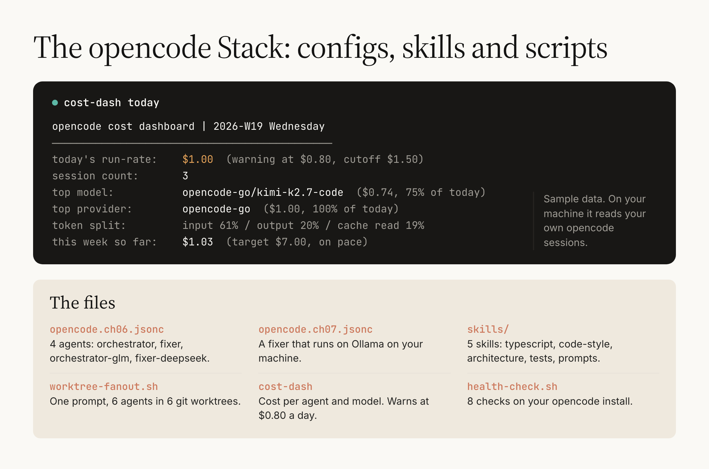

# opencode-stack

**The book's opencode configs, five skills and three scripts, ready to copy into your own project.**

Companion code for *The opencode Stack: Cancel Claude This Weekend*, from [youcanbuildthings.com](https://youcanbuildthings.com).

[](https://github.com/regardo911/opencode-stack/actions/workflows/ci.yml) [](LICENSE)



opencode is an open-source coding agent you run in a terminal. This repo holds the config files and small scripts the book has you build for it. The main config sets up two agents: an **orchestrator** that plans a change and a **fixer** that makes the edits, each on its own model ([chapters/06-routing](chapters/06-routing) explains both). Those models come from **OpenCode Go**, the opencode team's monthly plan of open-weight models (same folder). Find your line below, run its command, then use the copy table for the rest.

## Start here

Every command here runs from inside the clone:

```bash
git clone https://github.com/regardo911/opencode-stack && cd opencode-stack
```

### "I have opencode installed and want the two agents"

```bash
cp chapters/06-routing/opencode.ch06.jsonc ~/your-project/opencode.json
cd ~/your-project && opencode debug agent orchestrator
```

opencode prints the orchestrator with `"providerID": "opencode-go"`. Then follow [chapters/06-routing](chapters/06-routing) to run it on a real file.

### "I already use opencode and want to see what it cost me"

```bash
chapters/09-cost-dashboard/cost-dash today
```

It reads your own opencode sessions (read-only) and prints today's spend, your top model, and the week against $7.00.

### "Something is broken"

```bash
bash chapters/11-health-check/health-check.sh
```

Eight PASS/FAIL checks on your install.

### "I finished the book and want the files"

The table is next.

## Copy table

| Chapter | In this repo | Where it goes |
|---|---|---|
| 6 | `chapters/06-routing/opencode.ch06.jsonc` | `<your project>/opencode.json` |
| 7 | `chapters/07-self-host/opencode.ch07.jsonc` | merged into `~/.config/opencode/opencode.json` |
| 8 | `chapters/08-skills-and-fanout/skills/<name>/` | `~/.config/opencode/skills/<name>/SKILL.md` |
| 8 | `chapters/08-skills-and-fanout/worktree-fanout.sh` | `<your project>/tools/worktree-fanout.sh` |
| 9 | `chapters/09-cost-dashboard/cost-dash` | `<your project>/tools/cost-dash` |
| 10 | `chapters/10-ship-the-last-two/skill-template/SKILL.md` | `~/.config/opencode/skills/<your skill>/SKILL.md` |
| 11 | `chapters/11-health-check/health-check.sh` | `<your project>/tools/health-check.sh` |

## Chapter map

| Chapter | What you build | The command | Done when |
|---|---|---|---|
| 4 | your first cost row, after Project #1 | `cost-dash log --project project-01-static-hello` ([how](chapters/09-cost-dashboard)) | `cost-log.csv` has the book's header and a row |
| [6](chapters/06-routing) | Projects #3 and #4: two routing pairs in one file | `opencode --agent orchestrator`, then `--agent fixer` | 4 agents, 4 cost rows, a winner per axis |
| [7](chapters/07-self-host) | Project #5: a fixer on Ollama | `opencode --agent local-fixer` | tcpdump shows no packets, a $0 row |
| [8](chapters/08-skills-and-fanout) | Projects #6 and #7: five skills, the fan-out | `tools/worktree-fanout.sh "<prompt>"` | 6 diffs, 1 merged, the rest removed |
| [9](chapters/09-cost-dashboard) | Project #8: the cost dashboard | `cost-dash today` | the alert fires past $0.80; a weekly report exists |
| [10](chapters/10-ship-the-last-two) | Projects #9 and #10: the invoice tracker, your skill | `opencode debug skill` | your skill is listed; the ten-project table is filled |
| [11](chapters/11-health-check) | the Monday health check | `bash tools/health-check.sh` | `Summary: 8 PASS, 0 FAIL` |

Chapters 1 to 3, 5 and 12 have nothing to copy: they explain, or they reuse the files above.

## Which agent bills whom


You pick the agent; the agent's `model` line picks the model. The part before the slash picks who sends the bill: `opencode-go/` is your Go plan, `ollama/` is your own machine, and the book's `opencode/` is Zen, the per-request tier.

## What it needs

- opencode. Both configs were checked on 1.4.3 and 1.19.5.
- An OpenCode Go plan for chapters 6, 8 and 10, or Ollama for chapter 7.
- git, for the fan-out.
- `python3` 3.9 or newer for `cost-dash` (`python3 --version`). Nothing to pip install.

The agents are what you pay for: the orchestrator's plan, the fixer's edits and the fan-out's six diffs all bill your Go plan. `cost-dash log` turns each session into one cost row per agent. Tests: `bash tests/run.sh`. They use a stand-in `opencode` and made-up data, so no key, no account.

## Book fixes

Fifteen places where the printed book fails on today's opencode, each with the output that shows it, are in [BOOK-FIXES.md](BOOK-FIXES.md). The files here already carry the working line.

## Contributing, license

Fixes welcome, especially when opencode or OpenCode Go moves and a line here stops working; see [CONTRIBUTING.md](CONTRIBUTING.md). Every file names its chapter in its first lines.

MIT, see [LICENSE](LICENSE). Educational software, provided as-is, no warranty.
